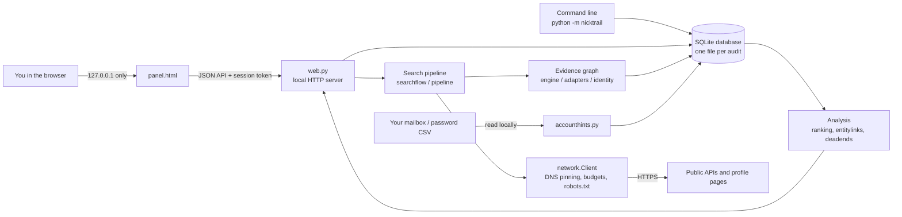

# How NickTrail works

This document describes the architecture, the technologies and the rules the code follows. It is
meant for contributors and for anyone who wants to know what the tool does before running it.

## Overview

Everything runs in one Python process on your computer. There is no backend service, no account
and no telemetry.

## Technologies

| Part | Technology | Why |
| --- | --- | --- |
| Core | Python 3.11+ **standard library only** (`http.server`, `http.client`, `ssl`, `socket`, `sqlite3`, `email`, `csv`, `zipfile`, `threading`) | Easy to install and audit; no supply-chain surprises. |
| Storage | SQLite, one file per audit, foreign keys on | Portable, private, easy to back up or delete. |
| Web panel | One HTML file with vanilla JavaScript and CSS, served by `ThreadingHTTPServer` | No build step, no framework, no CDN. |
| Graph | Hand-written SVG layout in the panel | Works offline; no charting library. |
| Optional rendering | Playwright + Chromium (`pip install ".[browser]"`) | Only for public pages that need JavaScript; all its traffic still goes through the pinned client. |
| Tests | `unittest` (offline fixtures), Node for panel scripts, an HTTP smoke test | Tests never touch real websites. |
| Site definitions | Own catalogs plus optional normalized [Sherlock](https://github.com/sherlock-project/sherlock) and [Maigret](https://github.com/soxoj/maigret) definitions (MIT) | Wide coverage in *Deep* mode; imported routes are treated as untrusted leads. |

## Data model

The database stores *what was observed* separately from *what you decided*:

- **nodes**: profiles, pages, emails and declarations, with their platform, state of the last read
  (`found`, `not_found`, `blocked`, `limited`, `error`, …) and your ownership label (`mine`, `not_mine`,
  `unknown`).
- **evidence**: directed relations between nodes (`links`, `claims_ownership`, `public_contact_occurrence`,
  `identity_contradiction`, …) with the source URL, location on the page and a short snippet.
- **observations / profile_addresses**: history of reads and old addresses of the same account.
- **search tasks and sources**: the queue of a search, so it can stop and resume exactly where it
  was.
- **account_hints**: services found in your mailbox or password export, with your decision.

Ownership is only ever set by you. Analysis is recomputed from the stored evidence and never writes
labels.

## Search pipeline

A search runs in stages (`pipeline.py`, `searchflow.py`, `stages.py`):

1. **Exact**: documented public APIs (GitHub, GitLab, Bluesky, Codeberg, Stack Exchange, Lichess,
   Keybase, forums, …), then strict profile-address templates, then (in *Deep*) the imported catalog.
   Each result must match the exact username and, where possible, a stable account ID.
2. **Enrich**: confirmed accounts are read first; public links in bios, website fields, `rel=me` and
   link-in-bio pages are recorded as evidence.
3. **Branches**: accepted links are followed with a fair, bounded budget per root account (at most
   ten descendants per root, depth three).
4. **Weak discovery**: similar names, search indexes you configured, and in *Deep* the Internet Archive
   index for addresses that contain a number or tag.

Searches are resumable. A site that fails, is cooling down after a rate limit, or keeps refusing is
deferred a limited number of times and then marked for a manual check, so one bad site never stops
the rest. Automatic resuming continues while the queue keeps shrinking and stops when it stalls.

Scan modes (`scanmodes.py`) set the scope and budgets:

| Mode | Sources | Requests per phase |
| --- | --- | --- |
| QUICK | 11 exact public APIs | 40 in 60 s, no resuming |
| STANDARD | all no-key sources and strict templates, links, similar names | 100 in 150 s, resumes |
| DEEP | Standard + imported catalog, indexes, configured instances, separator variants, archive search | 250 in 300 s, resumes |
| CUSTOM | your choice | your limits |

## Network client

All outgoing traffic goes through `network.Client`:

- resolves DNS once per request, **refuses private, loopback and reserved addresses** and connects to
  the pinned IP (prevents DNS rebinding and SSRF via redirects);
- ignores proxy environment variables, sends no cookies and no credentials except an API key to the
  host it belongs to;
- limits redirects, response size, time and the number of requests per domain and per search;
- respects `robots.txt` (RFC 9309) and `Retry-After`; refusals are remembered for 24 hours by default;
- reads up to three *different* sites at the same time (configurable 1–6); each single site is still
  read one request at a time with a pause.

Reading settings can make `robots.txt` handling follow the RFC more literally, but nothing in the
settings bypasses a sign-in, a CAPTCHA, a paywall or a block.

## Evidence and account groups

`identity.py` classifies a link from its context: "My GitHub is …" is an ownership claim, "I recommend
…" is a recommendation, a quote is a mention. `emailid.py` normalizes email addresses per provider
(for example Gmail dots and `+tags`) and compares public avatar hashes, without ever querying a
service with your email.

`entitylinks.py` builds **suggested account groups** from independent evidence: reciprocal links,
the same public contact, the same avatar email hash, a shared personal website. Usernames, display
names, photos and locations are ranking signals only; they never create a group. Sources that many
accounts share (a team website, a public company email) are recognized and skipped.

`ranking.py` orders candidates with explainable reasons. Scores are preferences, not probabilities.

## Forgotten accounts from your own data

`accounthints.py` streams an `.mbox`, `.eml` folder or `.zip` and reads only headers. It groups mail by
the sending service's domain (so `noreply@mail.accounts.example.com` counts as `example.com`),
ignores mail from people and from webmail providers, and recognizes sign-up, confirmation, password-reset, sign-in and deletion
messages in several languages. A password CSV is parsed locally row by row; only the URL and username cells are kept.
Subjects, bodies and passwords are never stored.

## Local web panel security

- binds to `127.0.0.1` only and checks `Host`, `Origin` and `Sec-Fetch-Site`;
- every state-changing request needs a per-session token (`X-NickTrail-Token`);
- strict Content-Security-Policy with a per-session script nonce; no external resources;
- avatars are proxied through the local server so the browser never contacts arbitrary hosts;
- one network worker per database (`runtime.py`), with recovery after a crash.

## Localization

Polish is the source language of the code and the panel; English is the default interface language.
`localization.py` translates the panel before it is served (`translations.json`) and translates only
listed presentation fields of API responses (`system_translations.json`), using exact entries,
anchored templates and longest-first fragments. Stored data, evidence snippets, URLs and identifiers
are never translated. No translation service is used.

## AI packet

`aipacket.py` builds a JSON or Markdown package from records **you select**, with optional redaction
(emails, names, locations, domains, snippets, pseudonyms) and a prompt in English or Polish. NickTrail
makes no network call for it; you copy it into an assistant yourself if you want a second opinion.

## Exposure checks

With your own Have I Been Pwned key and an explicit consent tick, `exposure.py` checks one email
address you enter and stores only breach names and dates. Breach data is never used to link accounts.

## Repository layout

| Path | Contents |
| --- | --- |
| `nicktrail/__main__.py` | command line |
| `nicktrail/web.py`, `panel.html` | local server and panel |
| `nicktrail/network.py` | the only HTTP client |
| `nicktrail/search*.py`, `pipeline.py`, `branches.py`, `autoresume.py` | search queue and stages |
| `nicktrail/adapters.py`, `native*.py`, `freeprofiles.py`, `community.py`, `forums.py`, `forge.py`, `gaming.py`, … | source-specific readers |
| `nicktrail/identity.py`, `emailid.py`, `entitylinks.py`, `ranking.py`, `graphsignals.py` | evidence and analysis |
| `nicktrail/accounthints.py`, `archivesearch.py` | forgotten-account helpers |
| `nicktrail/*.json` | site catalogs and translations |
| `tests/` | offline tests, panel checks, HTTP smoke test |
