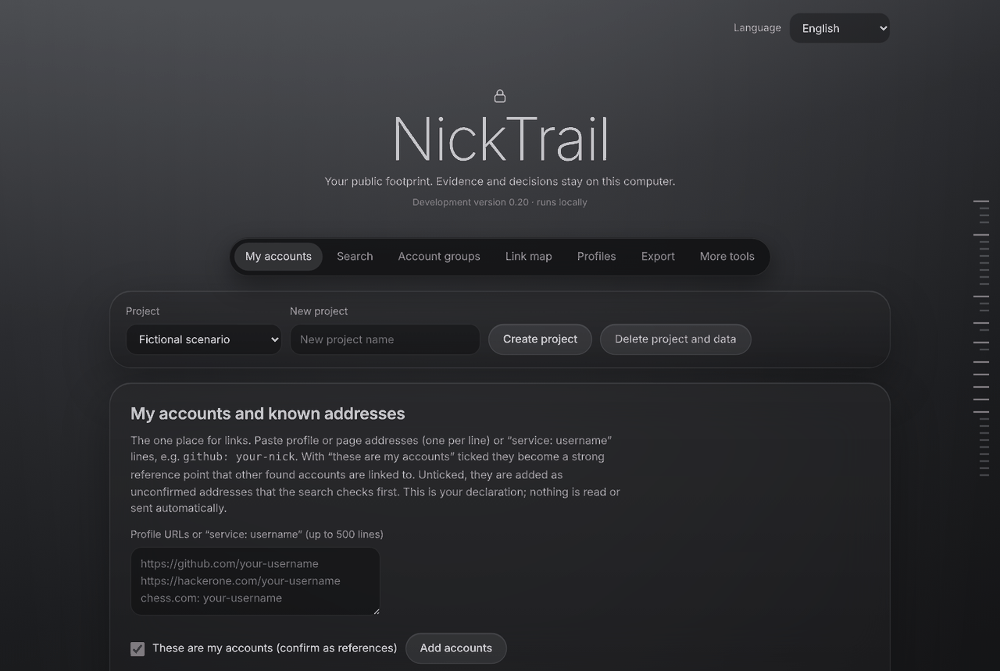
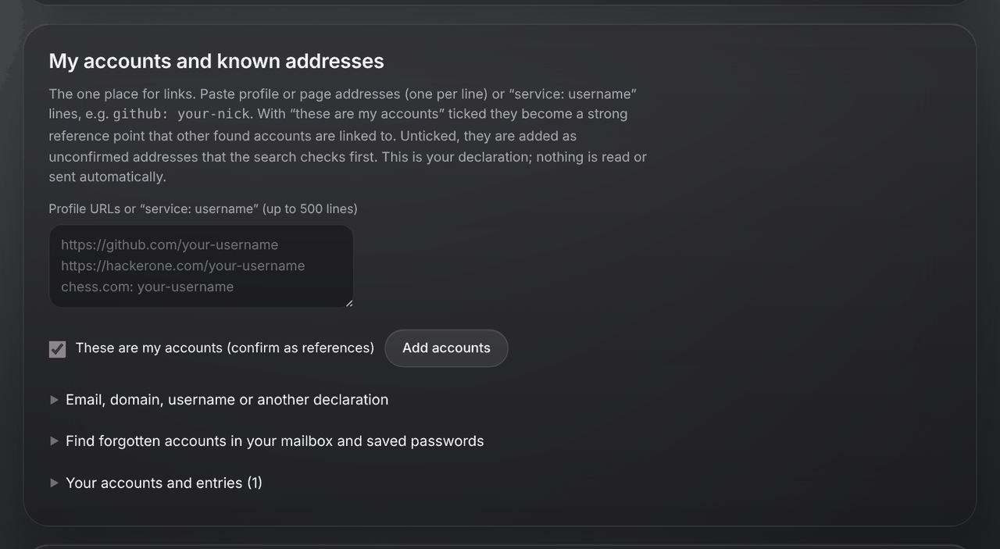
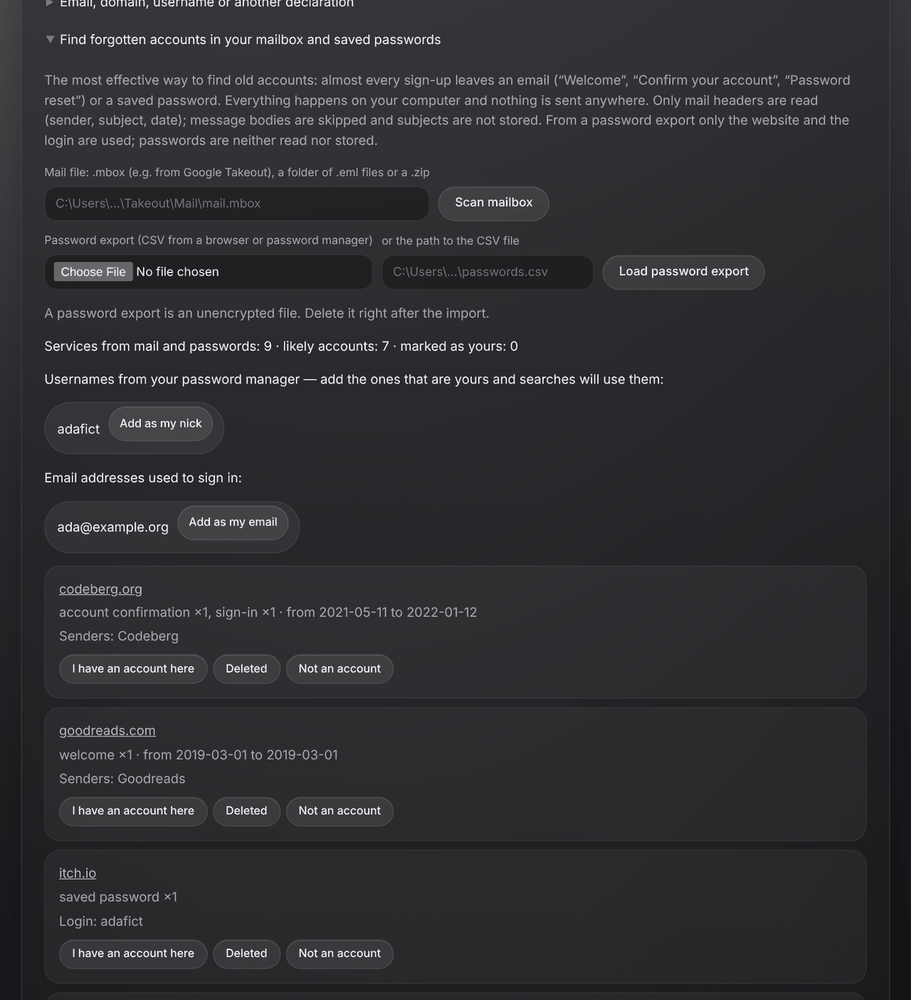
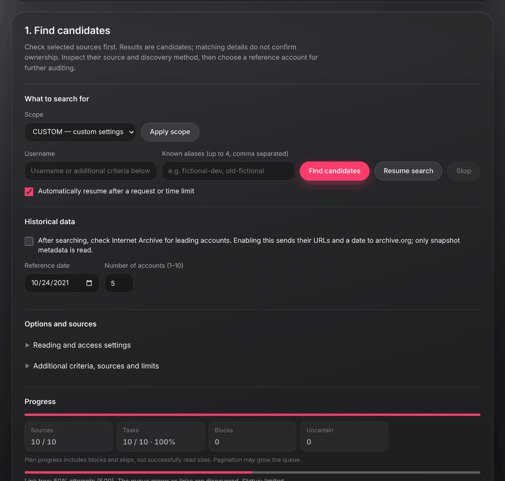
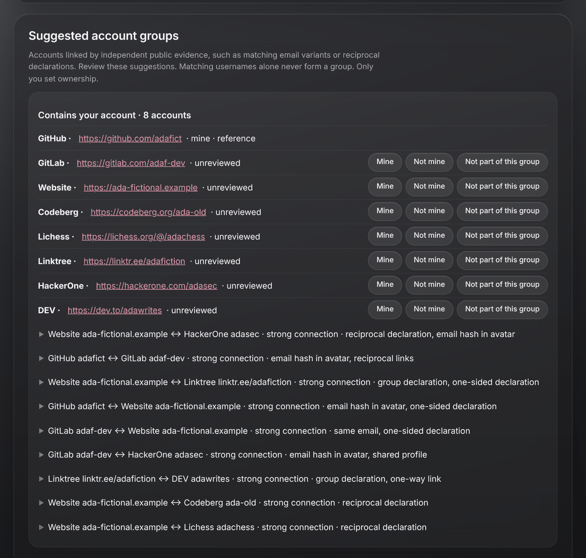
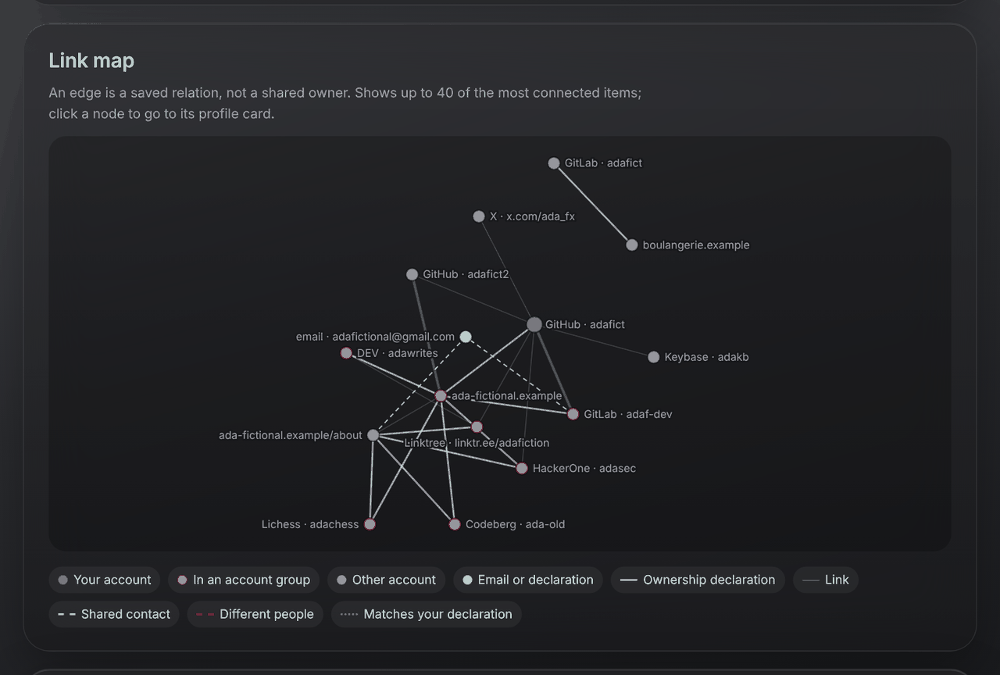
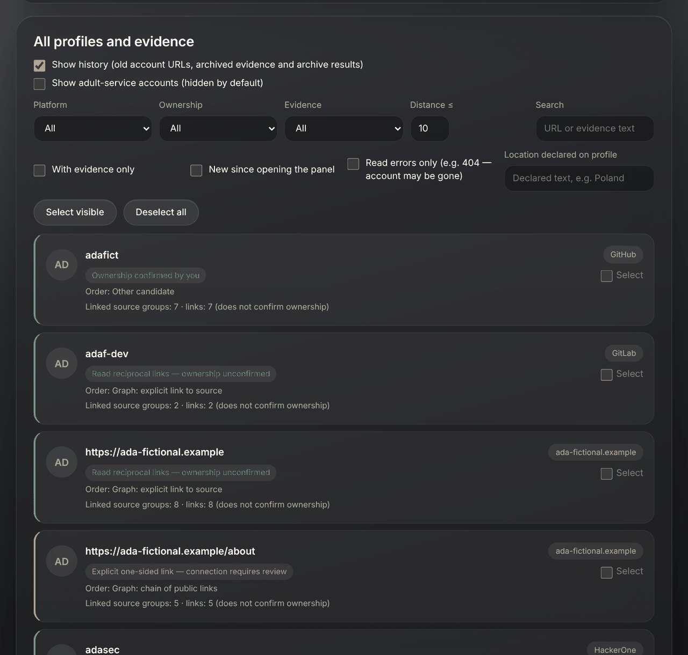
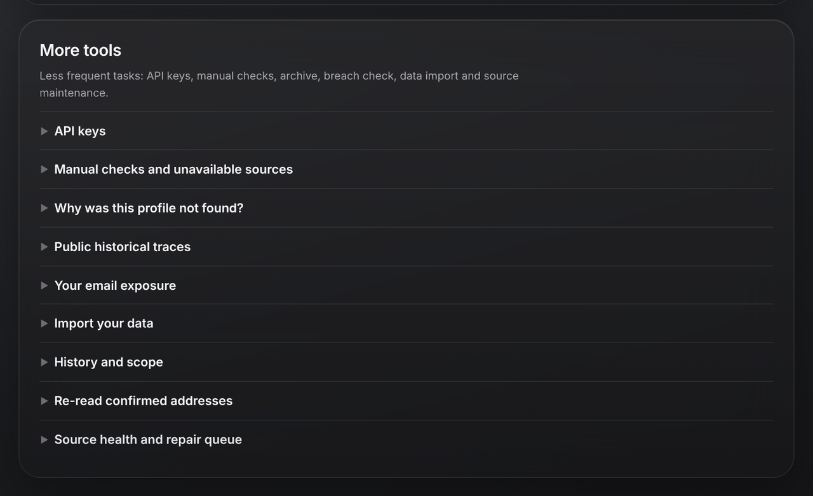

# User guide

This guide walks through a typical self-audit: from an empty project to a list of accounts you have
reviewed. All screenshots use fictional data.

- [1. Install and start](#1-install-and-start)
- [2. Create a project](#2-create-a-project)
- [3. Tell NickTrail what you already know](#3-tell-nicktrail-what-you-already-know)
- [4. Find forgotten accounts in your own data](#4-find-forgotten-accounts-in-your-own-data)
- [5. Search for candidates](#5-search-for-candidates)
- [6. Review the results](#6-review-the-results)
- [7. Follow links from one account](#7-follow-links-from-one-account)
- [8. Export, share or clean up](#8-export-share-or-clean-up)
- [Command line](#command-line)
- [Tips](#tips)

## 1. Install and start

You need Python 3.11 or newer. Nothing else is required.

```bash
git clone https://github.com/<you>/NickTrail.git
cd NickTrail
python -m nicktrail --db my-footprint.sqlite3 serve --port 8770
```

Open <http://127.0.0.1:8770/> in your browser. The panel only listens on your own computer. The
database file (`my-footprint.sqlite3` above) holds everything NickTrail finds and everything you decide,
so keep it private and back it up if it matters to you.

Optional: `python -m pip install ".[browser]"` adds Playwright for the few sites that only show a
profile after running JavaScript.

## 2. Create a project

A project is one audit, usually one person (you). Type a name under **New project** and press
**Create project**. **Delete project and data** removes the project and all of its results from the
database.



## 3. Tell NickTrail what you already know

Under **My accounts and known addresses**, paste links to accounts you know, one per line. You can
also write `service: username` lines, for example `github: your-nick` or `chess.com: your-nick`.



- With **These are my accounts** ticked, the links become *references*: confirmed accounts that other
  results are compared against. They are the strongest input you can give.
- Unticked, they are added as unconfirmed addresses that the next search checks first.

**Email, domain, username or another declaration** lets you record facts about yourself: an email
address you use, your own domain, an alias, the name you show publicly, a country. Declarations are
used in your searches (aliases are searched, a display name and country help ranking). Email
addresses are **never** sent to search services; they are only compared with what public profiles
already show.

## 4. Find forgotten accounts in your own data

Most old accounts left a trace in your mailbox ("Welcome to…", "Confirm your email", "Reset your
password") or in your password manager. Open **Find forgotten accounts in your mailbox and saved
passwords**:



- **Mailbox**: give the path to an `.mbox` file (for example from Google Takeout), a folder of `.eml`
  files or a `.zip`. Only headers are read (sender, subject, date). Message bodies are skipped and
  subjects are not stored. Personal mail is ignored; only mail from services counts.
- **Password export**: choose the CSV file your browser or password manager exports. Only the
  website and login columns are read. Passwords are never read or stored. Delete the CSV afterwards:
  it is an unencrypted file.

Each service appears as a card with what was seen and when. Mark it **I have an account here**,
**Deleted** or **Not an account**. Logins found in the password export appear as chips; **Add as my
nick** adds one to your declarations so searches use it. Services you mark as yours are also checked
in the Internet Archive when you run a *Deep* search.

Nothing in this step uses the network.

## 5. Search for candidates

In **1. Find candidates**, type your username (and up to four known aliases) and press **Find
candidates**.



Choose a **scope** first:

| Scope | What it does | Typical time |
| --- | --- | --- |
| **QUICK** | About a dozen exact public APIs. No link following. | about a minute |
| **STANDARD** | All no-key sources and about 100 strict profile-address templates, then links from your accounts and similar names. Resumes itself while the queue keeps shrinking. | a few minutes |
| **DEEP** | Everything in Standard plus the optional imported catalog (Sherlock/Maigret definitions), configured search indexes, separator variants (`nick_name` / `nick.name` / `nick-name`) and Internet Archive search for profile addresses with a number or tag. | 10–30 minutes |
| **CUSTOM** | Your own choice of sources, limits and resuming. | depends |

Progress, an estimated finish time and the number of blocked or uncertain sources are shown while the
search runs. You can **Stop** at any time and **Resume search** later; finished work is kept.

A site that refuses, rate-limits or shows a CAPTCHA is *not* retried with tricks. It becomes a
**manual check**: NickTrail gives you the address and you open it yourself.

Under **Options and sources** you will find reading settings (how `robots.txt` is interpreted, how many
different sites are read at the same time) and extra criteria such as first name, location or
keywords that only affect ranking.

## 6. Review the results

### Account groups

NickTrail groups accounts that are connected by **independent public evidence**, such as a profile
that links to another and is linked back, the same public email address on both, or the same
email hash in their avatars. A matching username alone never puts two accounts in one group.



For each account choose **Mine**, **Not mine** or **Not part of this group**. Expand a connection to
see exactly which evidence produced it and where it came from.

### Link map

The link map draws the same evidence as a graph. Green is your confirmed account, pink nodes are in a
group with it, grey nodes are other candidates, blue nodes are emails or your declarations. Click a
node to jump to its profile card.



### All profiles and evidence

Every profile, page and email NickTrail knows about, with filters for platform, ownership, evidence,
distance from your accounts, read errors (for example a 404 that suggests the account is gone) and
the location a profile declares.



Labels such as *Ownership confirmed by you*, *Read reciprocal links — ownership unconfirmed* or
*Explicit one-sided link — connection requires review* describe the evidence, not a probability.

### Other analysis

- **Worth checking now**: a short, rule-based list of checks that would clarify the most. Nothing in it
  runs on its own.
- **Unused leads** (under account groups): identifiers found on your accounts (another alias, a domain)
  that no search has used yet.

### More tools

Less frequent tasks are collapsed at the bottom of the panel, under **More tools**:



- **API keys**: optional keys for extra sources (see below).
- **Manual checks and unavailable sources**: everything that needs you to open a page yourself.
- **Why was this profile not found?**: paste an address you know exists and NickTrail explains, without
  using the network, which step would have found it and why it did not.
- **Public historical traces**: look up one saved address in the Internet Archive on a chosen date,
  with a preview of exactly what will be requested.
- **Your email exposure**: breach check for your own email (see below).
- **Import your data**: import your own posts or a Maigret report.
- **History and scope**: every scan with its limits and errors.
- **Re-read confirmed addresses**: read your confirmed accounts again with chosen limits.
- **Source health and repair queue**: for maintainers. Shows, from recorded checks only, which
  services currently work, are broken, block automated reads or need a sign-in, so their definitions
  can be fixed. It starts no scan.

## 7. Follow links from one account

Pick an account as the **selected account** (section 2 of the panel). NickTrail reads it and the links
it publishes, records what it finds, and shows new candidates connected to it. Mentions and
recommendations ("I recommend…", quotes) are recorded but never followed automatically.

## 8. Export, share or clean up

- **Export**: JSON, Markdown or HTML, with options to leave out email addresses or chosen records.
  Accounts on sensitive (adult) sites are left out unless you include them explicitly.
- **AI analysis package — export only**: builds a redacted text you can paste into an AI assistant of
  your choice, with a ready-made prompt asking it to review the evidence. NickTrail does not send it
  anywhere; you decide whether to share it. Redaction options hide emails, names, locations, domains
  or snippets, or replace identifiers with pseudonyms.
- **Your email exposure** (under More tools): with your own Have I Been Pwned key and an explicit consent tick, checks
  which known breaches list your email address (breach names and dates only).
- **API keys** (under More tools): optional keys for Brave Search, Have I Been Pwned, Steam, Twitch, Xbox (OpenXBL),
  Mastodon, X, Mojeek, Google Programmable Search and SearXNG. They are stored in your user config
  folder, never in the project database or exports.

When you are done, use the list of accounts marked **Mine** as your clean-up list: delete what you
no longer use, lock down what you keep, and update old profiles.

## Command line

Everything the panel does is also available from the command line:

```bash
python -m nicktrail --db my.sqlite3 create "My audit"          # prints the project id
python -m nicktrail --db my.sqlite3 add 1 https://github.com/your-nick --confirmed
python -m nicktrail --db my.sqlite3 discover 1 your-nick --mode STANDARD
python -m nicktrail --db my.sqlite3 clusters 1
python -m nicktrail --db my.sqlite3 export 1 --format markdown --output report.md
python -m nicktrail --help                                      # all commands
```

Command-line messages are in English; set `NICKTRAIL_LANG=pl` for Polish.

`python -m nicktrail --db demo.sqlite3 demo` builds a small fictional project without using the
network, if you want to look around first.

## Tips

- Start with **STANDARD**. Use **DEEP** once you have confirmed a few accounts; it has much more to
  compare against then.
- Confirm accounts early. Every confirmed account makes the next search and the groups more accurate.
- A missing result never proves an account does not exist. Sites change, block automated reads, or
  hide profiles from logged-out visitors.
- The panel is available in English and Polish (selector in the top-right corner).
